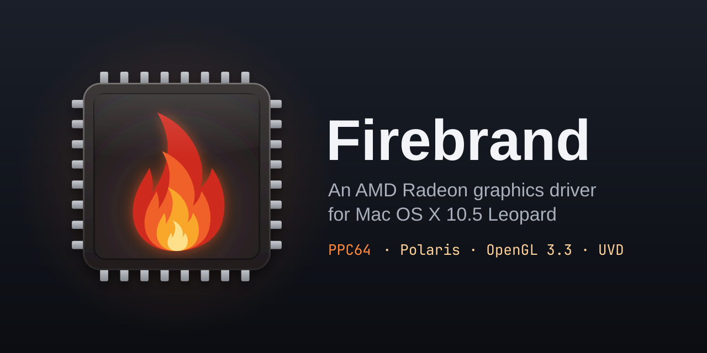
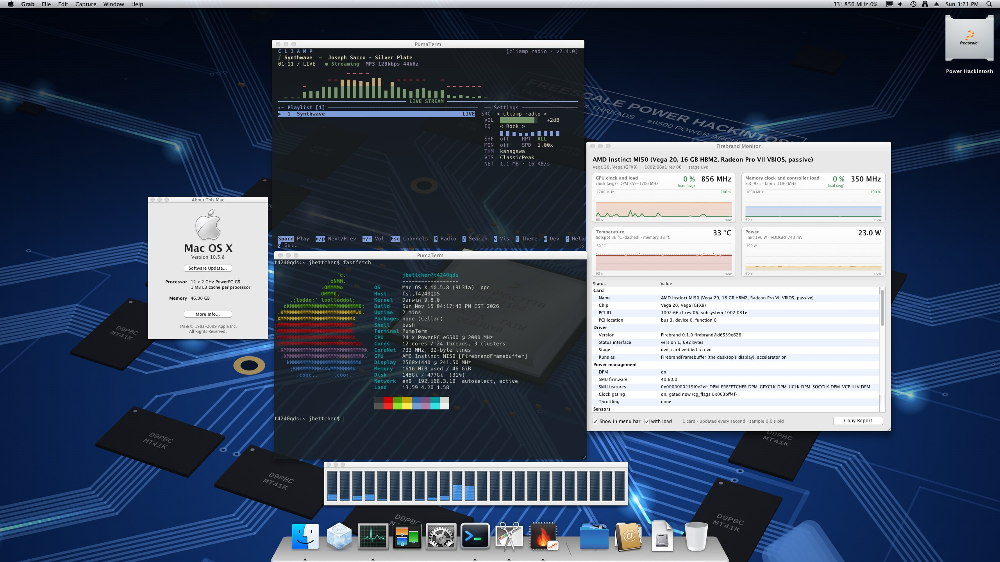
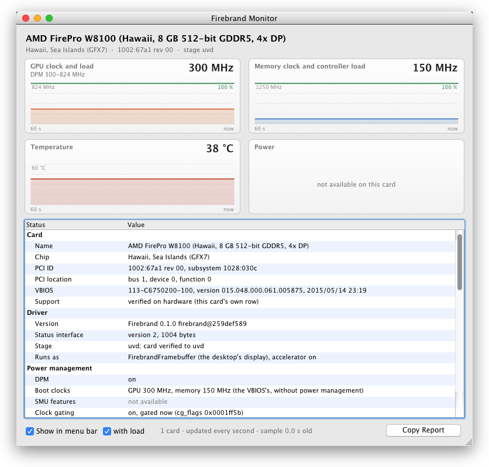

<p align="center"></p>

# Firebrand

Firebrand is a graphics driver for AMD Radeon cards on Mac OS X 10.5 Leopard on PowerPC.
It brings four generations of GCN cards to Leopard: Southern Islands (GCN 1), Sea Islands
(GCN 2), Polaris (GCN 4) and Vega 20 (GCN 5); [Status](#status) says what has been verified
on each. On a verified card: the desktop over DisplayPort at up to 3840x2160 at 60 Hz or over
HDMI, Quartz Extreme and Core Image on the GPU, OpenGL through Mesa's radeonsi driver (up to
OpenGL 4.6), hardware H.264 decoding, DisplayPort audio and power management. Every other
card of these families loads too, display-only until you unlock it
([Your card isn't listed as verified?](#your-card-isnt-listed-as-verified)).

[](art/desktop-mi50.jpg)

<sub>Leopard 10.5.8 on a 12-core, 24-thread NXP T4240 with an AMD Instinct MI50 (Vega 20) under Firebrand at 2560x1440. Firebrand Monitor is on the right.</sub>

The kernel driver is written after Linux's **amdgpu**: one file per hardware block
(`gmc_v8_0`, `gfx_v8_0`, `sdma_v3_0`, `uvd_v6_0`, `dce_v11_0`, the SMU7 powerplay code), with
amdgpu's function names, so code ports from Linux file for file. Every structure the GPU reads
is written little-endian explicitly, which is what a big-endian host needs and what amdgpu
never had to do. The userland (the OpenGL bundle, the window server's 2D plug-in and the video
library) comes from [RadeonNI-OSX](https://github.com/kouta-kun/RadeonNI-OSX), whose interface
Firebrand's accelerator speaks, with Mesa's radeonsi made to run on a big-endian host.

> **Status: early.** Firebrand runs today on Mac OS X 10.5.8 on NXP QorIQ T4240 (e6500)
> systems, where everything below was measured. **Power Mac G5:** Firebrand and HDAudio
> take every device address through IOKit (`IODMACommand`), which on a G5 goes through its DART
> IOMMU, so the same build is meant for both machines. It has not been run on a G5 yet; see the
> [roadmap](#roadmap). There is no installer package or binary release yet; see
> [Building](#building).

## Status

What has been verified on hardware, by family. The dates are the last run on that card; the
ones marked *this release* ran the driver and OpenGL bundle in this repository as they are.

| Family | Verified card | Verified on hardware | Last run |
|---|---|---|---|
| **Southern Islands** (GCN 1) | Radeon R7 450 | The display over DisplayPort (up to 3840x2160 at 60 Hz), 2D, Quartz Extreme, Core Image, OpenGL 4.5, power management, DisplayPort audio, H.264 decoding (UVD 3.1, 12 test streams bit-exact) | 2026-11-15, with the driver of that day. Since then the driver changed outside Southern Islands (Sea Islands, the untested-card policy) and, within it, only for the other chips: Cape Verde's tables and microcode files are the same, checked by the host tests. The card was not fitted for this release's run. |
| **Sea Islands** (GCN 2) | FirePro W8100 | The display over DisplayPort (the desktop at 2560x1440, a 3840x2160 at 60 Hz link), 2D, Quartz Extreme, Core Image, OpenGL 4.5, power management (clocks follow the load, fan control), DisplayPort audio, H.264 decoding (UVD 4.2, 12 streams bit-exact) | 2026-11-15, *this release* |
| **Polaris** (GCN 4) | Radeon RX 550 | 2D, Quartz Extreme, Core Image, OpenGL 4.6, H.264 decoding (UVD 6.3, 12 streams bit-exact), power management (214-1183 MHz under load) | 2026-11-15, without a monitor, with the driver of that day; since then Polaris's GART is 1 GB with the accelerator (256 MB before), run on the RX 570. The display over DisplayPort at up to 3840x2160 at 60 Hz, hot-plug and DisplayPort audio: 2026-11-14. |
| | Radeon RX 570 | The display over HDMI (2560x1440 at 60 Hz, modes from the monitor's EDID and its CEA extension), 2D, Quartz Extreme, Core Image, OpenGL 4.6, H.264 decoding (UVD 6.3, 12 streams bit-exact, about 92 pictures/s at 1080p), power management (clocks follow the load: 1244 MHz engine and 1750 MHz memory clock under load, 300 and 300 MHz idle) | 2026-11-19, *this release* |
| | Embedded Radeon E9173 | The display over its three DisplayPort outputs, 2D, Quartz Extreme, Core Image, OpenGL 3.3, H.264 decoding (UVD 6.3), power management, DisplayPort audio | 2026-11-14 |
| **Vega 20** (GCN 5) | Instinct MI50 | The display over DisplayPort, Quartz Extreme, Core Image, OpenGL 4.6, H.264 decoding (UVD 7), power management and clock gating, DisplayPort audio | 2026-11-15, with the driver of that afternoon; its Vega 20 code is unchanged since and passes the register-trace replays against Linux on both byte orders. The DMA engine occasionally stalls on its first frame after a start; the driver detects that and recovers it by itself (about 35 ms). |

Not yet, on any family: DVI on a monitor (implemented, not tried; HDMI is verified on the RX
570 only), HDMI audio, video encoding
(VCE), 1080p60 decoding in real time (1080p30 and 720p60 play without dropped frames),
interrupts (the driver polls), compute queues.

## Supported cards

Verified on hardware (each has its own row in `amdgpu/frb_drv.c`, which caps how far the
bring-up goes):

| Card | GPU | PCI IDs |
|---|---|---|
| AMD Radeon R7 450 (Dell, 4 GB, DP + DP + DVI) | Cape Verde (Southern Islands) | `1002:682b` rev `87`, subsystem `1028:1004` |
| AMD FirePro W8100 (Dell, 8 GB, 4x DP) | Hawaii (Sea Islands) | `1002:67a1` rev `00`, subsystem `1028:030c` |
| AMD Radeon RX 550 (4 GB, DP + HDMI + DVI) | Polaris 12 | `1002:699f` rev `c7`, subsystem `1002:0b04` |
| Sapphire Radeon RX 570 (8 GB, 2x DP + 2x HDMI + DVI) | Polaris 20 (Polaris 10 to amdgpu) | `1002:67df` rev `ef`, subsystem `1da2:e366` |
| AMD Embedded Radeon E9173 (2 GB, 3x DP) | Polaris 12 | `1002:699f` rev `81`, subsystem `1002:ea73` |
| AMD Instinct MI50 (16 GB HBM2, mini-DP, Radeon Pro VII firmware) | Vega 20 | `1002:66a1` rev `06`, subsystem `1002:081e` |

Every other Southern Islands, Sea Islands (Bonaire, Hawaii), Polaris (10, 11, 12, Vega M) and
Vega (10, 12, 20) card in Linux amdgpu's device table matches too: 155 device IDs, the
driver's `IOPCIMatch` (made from `amdgpu/frb_drv.c` by `kext/Firebrand/mk-pcimatch.pl`). Such
a card is an **untested card**; see the next section.

## Your card isn't listed as verified?

It loads display-only. A card that is not one of the verified cards above starts with the
display stage (`dce`) only: Firebrand drives the desktop, without Quartz Extreme, OpenGL
acceleration or video decoding. Sea Islands and Vega 20 cards also run power management,
which those families start before the display (as on their verified cards); Southern Islands
and Polaris cards stay at their boot clocks.

Today a picture comes up on cards with the same chip as a verified card (Cape Verde, Hawaii,
Polaris 12 and Vega 20). Tahiti, Pitcairn and Oland (Southern Islands), Bonaire (Sea Islands),
Polaris 10 and 11 (the RX 460 to 580 generation and its Pro and embedded relatives) and the
kicker revisions of Polaris 12 and Hawaii have their microcode carried and their display path
complete, ported from amdgpu, but have not been run on hardware: no card of these chips has
been tried yet. Unlocked, Polaris 10 and 11 stop at the graphics stage, which is ported for
Polaris 12 only. Hainan has no display engine, and Vega M is only ever part of Intel's Kaby
Lake G packages.

Vega 10 and Vega 12 (RX Vega 56 and 64, Vega Frontier Edition, Radeon Pro Vega) are only
identified: Firebrand has no port for them yet and writes nothing to the card.

To try acceleration:

```sh
sudo frbctl unlock      # every stage for this card, from the next start on
sudo frbctl stage 7     # optional: bring the rest up now, without a restart
sudo reboot             # Quartz Extreme and OpenGL start with the driver
```

`frbctl unlock` sets `FirebrandUnlock` in the installed driver
(`/System/Library/Extensions/Firebrand.kext`), so it lasts across restarts; `sudo frbctl
lock` goes back to display-only and `frbctl unlock status` shows the setting.
`sudo ./install.sh --unlock` installs unlocked. A verified card is not affected either way. If
an unlocked card misbehaves at startup, start once with the boot argument `frb_unlock=0` (on a
G5, set it beforehand with `sudo nvram boot-args="frb_unlock=0"`, or in Open Firmware) or in
single-user mode (hold Command-S; Firebrand does not load there), then run `sudo frbctl lock`.

Please report with Copy Report ([how, step by step](#reporting-a-card)): [Firebrand Monitor](#firebrand-monitor)'s **Copy Report** (or
`frbctl report --md` in Terminal) puts on the clipboard what an issue needs: the card's IDs and
subsystem, its VBIOS version, the stage it reached and the text of any stage that failed, its
clocks and temperature. Paste it into an [issue](https://github.com/jbettcher-wg/firebrand/issues),
with what you tried and what worked or broke, display-only and unlocked. That is how a card
gets its own verified row.

## Features

On Polaris; [Status](#status) has the other families, which have the same features unless it
says otherwise.

- **Display:** DisplayPort from 1.62 to 5.4 Gbit/s per lane (RBR to HBR2), up to 3840x2160 at
  60 Hz, with modes from the monitor's EDID. A monitor can be plugged into any port at any
  time (hot-plug). Hardware cursor, display sleep, 32, 16 and 8 bits per pixel. With no monitor
  the framebuffer still runs (headless). There is a boot screen with the Firebrand logo.
  HDMI works (RX 570: 2560x1440 at 60 Hz, modes from the EDID's CEA extension block too);
  DVI is implemented but has not been tried on a monitor yet.
- **Quartz Extreme and Core Image** on the GPU, at any monitor resolution. (Until 2026-11-19
  a monitor of 2560x1440 or less got the window server compositing on the CPU: it counts the
  driver's video memory range, which held only the screen, against a 16 MB minimum.)
- **OpenGL** through Mesa's radeonsi driver (`RadeonNIGLDriver.bundle`), for 32- and 64-bit
  programs: OpenGL 2.1 for ordinary programs (Leopard's OpenGL framework stops at 2.1),
  OpenGL 3.3 core profile for programs that choose its renderer (ID `0x00021a01`), and through
  RadeonNI's bridge (`RDNGLRequestCompatibilityContext`, which SDL 3 uses) up to OpenGL 4.6
  compatibility profile on Polaris and Vega 20, 4.5 on Southern and Sea Islands.
- **2D acceleration:** the window server's fills, copies and region moves run on the SDMA
  engines (`RadeonNIGA.plugin`).
- **H.264 decoding** on the card's UVD 6.3 engine, Baseline to High profile up to 1080p60,
  bit-exact against FFmpeg on 12 test streams: about 60-77 pictures/s at 1080p and 140-150
  at 720p on an RX 550. Programs use it through RadeonNI's `'rdnv'` client library
  (`radeonni/video`); the FrostByte browser does.
- **Power management:** amdgpu's powerplay with the SMU7. Clocks follow the load (RX 550:
  214-1183 MHz engine clock, up to 1500 MHz memory clock), the memory clock switches under a
  live display without a visible glitch, and the fan and thermal control are the SMU's.
- **DisplayPort audio** to the monitor, with the `HDAudio` kext.
- **Recovery:** a graphics or SDMA ring that stops for 2 seconds is reset by a watchdog (the
  reset itself takes 28-57 ms), and reloading the driver resets the GPU.

Not yet: HDMI audio, video encoding (VCE), interrupts (the driver polls), compute queues, and
unloading the driver after the window server has opened it (restart instead).

## Requirements

- Mac OS X **10.5.8** on PowerPC, with a PCI Express slot. See the status note above for which
  machines that currently means.
- A supported card and a DisplayPort or HDMI monitor.
- To build: a Linux or macOS machine for the OpenGL bundle and the firmware, and Xcode 3.1
  on the Mac for the kexts (see [Building](#building)).

## Installing

Firebrand is installed from the folder the build produces, `build/dist/Firebrand`. Read all
of this before starting: a card without a driver shows nothing at all, so you need a way back.

**Before you start**

1. Turn on **Remote Login** (System Preferences > Sharing) and check that you can log in
   with `ssh` from another computer. Note the Mac's address.
2. Leave the **old graphics card** in the Mac for the installation.

**Install**

```sh
cd Firebrand          # the build/dist/Firebrand folder, copied to the Mac
sudo ./install.sh
```

This installs into `/System/Library/Extensions`:

| Item | What it is |
|---|---|
| `Firebrand.kext` | the driver, set up as the framebuffer with 2D, OpenGL, video, power management and audio |
| `RadeonNIGLDriver.bundle` | the OpenGL driver (`--no-gl` leaves it out) |
| `RadeonNIGA.plugin` | the window server's 2D plug-in |
| `HDAudio.kext` | DisplayPort audio (`--no-audio` leaves it out) |

and `frbctl` into `/usr/local/bin`. Each kext is checked with `kextload -nt` (which loads
nothing) before anything is replaced. An OpenGL bundle or 2D plug-in from another driver
(RadeonNI uses the same names) is saved first and put back by the uninstaller.

Then shut down, put the AMD card in, connect a **DisplayPort** or **HDMI** monitor and start
the Mac.
There is **no picture until the driver starts**: PC graphics cards have no Open Firmware
driver, so the grey boot screen does not appear. Once Firebrand starts, its boot screen
appears, then the login window.

To check: `frbctl info` (the card, the bring-up stage, video memory) and System Profiler >
Graphics/Displays ("Quartz Extreme: Supported", "Core Image: Hardware Accelerated").

**If System Profiler shows 2047 MB** for a card with more memory (on the system the RX 570 was
tested on, it read the size as a signed 32-bit number), `frbctl info` shows the real size, and
`sudo ./patch-system-profiler-vram.sh` (in the same folder) makes System Profiler read the size
in MB that Firebrand publishes beside the capped one. It only patches Apple's 10.5.8 file,
refuses anything else, keeps the original, and `--restore` puts it back.

**If the screen stays dark**

- Log in with ssh and run `sudo ./uninstall.sh` in the same folder, then `sudo reboot`; or
- log in with ssh and run `sudo nvram boot-args="frb_enable=0"`, then restart: the driver
  stays installed but does not start (`sudo nvram -d boot-args` undoes this); or
- put the old card back and start in **Safe Mode** (hold Shift while the Mac starts; no
  third-party drivers load), then run `sudo ./uninstall.sh`; or, with the old card back,
  start in **single-user mode** (hold Command-S; Firebrand does not load there) and run
  `mount -uw /`, `rm -rf /System/Library/Extensions/Firebrand.kext`,
  `touch /System/Library/Extensions`, `reboot`.

## Firebrand Monitor

<p align="center"></p>

`Firebrand Monitor.app`, in the same `build/dist/Firebrand` folder (copy it to Applications),
shows what the card is doing:

- **In the menu bar:** the card's temperature, GPU clock and GPU load, such as
  "48° 1.7 GHz 85%". Its menu lists each card's clocks, loads, temperatures and power.
- **In its window:** a minute of history for the GPU clock and load, the memory clock,
  the temperature and the power, one page per card, and under the graphs the driver's state:
  the card and its VBIOS, whether it is verified or untested (and unlocked), the bring-up
  stage and any stage that failed, power management and the VBIOS's boot clocks, the
  displays and their DisplayPort links, the video decoder, the PCIe link and video memory in
  use. An untested card is marked as one on its page and in the window's footer.
- **Copy Report** puts all of it on the clipboard, ready to paste into a GitHub issue.
  `frbctl report --md` prints the same in Terminal, and both describe a card even when the
  driver did not stay on it (a card that stopped before the display, or a Vega 10/12 card
  Firebrand only identifies).

### Reporting a card

Whether your card works, half works or doesn't come up at all, a report helps. It is how a
card gets its own verified row.

1. Open Firebrand Monitor and go to your card's page. The **Support** row says whether the
   card is verified or untested, and **Stage** shows how far it got.
2. Click **Copy Report** at the bottom right.
3. [Open an issue](https://github.com/jbettcher-wg/firebrand/issues/new), paste the report,
   and add what you tried and what worked or broke. If you unlocked the card, say how it did
   display-only and unlocked.

If the desktop doesn't come up, run `frbctl report --md` from another machine over ssh
(Remote Login) and paste that instead.

It needs no administrator password: it only reads, through a read-only connection to the
driver that any user may open. Every control stays in `frbctl`. To start it at login, add it
under System Preferences > Accounts > Login Items: started that way it shows no window, only
its menu-bar item and Dock icon; click the Dock icon, or choose "Open Firebrand Monitor…" from
its menu, for the window.

The readings depend on the card (as run 2026-11-15):

| Card | Live readings |
|---|---|
| Instinct MI50 (Vega 20) | all: clocks, load, temperatures (edge, hotspot, memory), power and its limit, voltage, throttling, clock gating |
| Radeon RX 550 (Polaris 12) | clocks, GPU and memory-controller load, temperature, power and its limit, voltage (it has no fan tachometer) |
| FirePro W8100 (Hawaii) | clocks, temperature, fan, clock gating; no power, load or voltage reading yet |
| Radeon R7 450 (Cape Verde) | clocks, temperature, voltage, clock gating |
| an untested card, display-only | its identity, VBIOS, stage and boot clocks, and the temperature; on Sea Islands and Vega 20, which run power management, the clocks too |

## Uninstalling

```sh
sudo ./uninstall.sh
```

removes what `install.sh` installed and restores the saved OpenGL bundle and 2D plug-in.
Restart afterwards.

## Building

The pieces are built in three places:

| Piece | Built on | With |
|---|---|---|
| AMD microcode (`firmware/`) | a Linux or macOS machine | `curl`, `sha256sum` or `shasum`, `zstd` or `xz` |
| `RadeonNIGLDriver.bundle` (Mesa) | a Linux or macOS machine | a `powerpc-apple-darwin9` GCC 15.3 cross toolchain and the Mac OS X 10.5 SDK |
| `Firebrand.kext`, `HDAudio.kext`, `RadeonNIGA.plugin`, `frbctl`, `Firebrand Monitor.app` | the Mac: Mac OS X 10.5.8 | Xcode 3.1 (Apple gcc 4.0.1, the 10.5 SDK) |

The kexts need Apple's gcc 4.0.1: the kernel's C++ ABI is that compiler's. Mesa needs a
current GCC. The microcode download needs a current TLS stack, which 10.5 lacks.

**The toolchain and the SDK.** The cross toolchain is the one the
[FrostByte](https://github.com/jbettcher-wg/frostbyte) browser uses. In a FrostByte checkout,
`./build.sh sdk toolchain --sdk=/path/to/xcode314_2809_developerdvd.dmg` downloads a
prebuilt toolchain (or builds it) and imports the SDK from your copy of Xcode 3.1.4. Apple's
licence does not allow the SDK to be redistributed, so you supply it.

**From a clone:**

```sh
git clone https://github.com/jbettcher-wg/firebrand
cd firebrand
./build.sh firmware                           # the AMD microcode, checksum-verified
FROSTBYTE=~/frostbyte ./build.sh gl fat       # the OpenGL bundle, 32- and 64-bit
./build.sh mac user@your-mac                  # the rest, built on the Mac over ssh
```

`./build.sh mac` copies the tree (with `firmware/` and the OpenGL bundle) to the Mac, runs
`scripts/build-mac.sh` there and brings back `build/dist/Firebrand`. On the Mac itself,
`./build.sh native` does the same once `firmware/` and `build/gl/` are there.
The kext embeds the Vega 20 microcode by default (`FRB_BRINGUP=vega20`); `FRB_BRINGUP=`
leaves it out, and a Vega 20 card then stops before its display comes up.

Leopard's sshd (OpenSSH 4.5) only speaks algorithms a current OpenSSH client has turned off,
so enable them for the Mac in `~/.ssh/config`:

```
Host your-mac
    HostKeyAlgorithms +ssh-rsa
    PubkeyAcceptedAlgorithms +ssh-rsa
    KexAlgorithms +diffie-hellman-group14-sha1
    Ciphers +aes128-cbc
    MACs +hmac-sha1
```

`LEOPARD_TOOLCHAIN` and `LEOPARD_SDK` can name a toolchain and SDK directly, instead of
`FROSTBYTE`. `radeonni/build-gl.sh` downloads Mesa 26.2.4 and puts meson and mako in a private
Python environment under `build/`; it checks the bundle it makes (all 66 entry points Leopard's
GL engine needs, no unresolved symbols, system libraries only), because the GL engine falls
back to software rendering without a word when it rejects a bundle.

`scripts/build-mac.sh` checks every kext it builds for 24-bit branches. A kext is loaded about
2.3 GB away from the kernel's code, so every call must be a long branch (`-mlong-branch`).

## How it works

**Bring-up stages.** The driver brings a card up in the order amdgpu does, in stages that can
be stopped at:

| Stage | What runs |
|---|---|
| 0 survey | identity, VBIOS (from the card's ROM), AtomBIOS command tables; no register writes |
| 1 post | AtomBIOS `ASIC_Init` when the card is not posted |
| 2 gmc | memory controller, its microcode, VRAM and GART |
| 3 smu | the SMU and its firmware |
| 4 dce | the display engine: connectors, EDID, link training, modes |
| 5 gfx | the graphics engine (RLC, CP), ring and IB tests |
| 6 sdma | both SDMA engines; after this, power management (DPM) |
| 7 uvd | the video decoder |

`install.sh` sets the installed driver to stage 7 with everything on. A verified card's row in
`amdgpu/frb_drv.c` caps the stage; an untested card stops at stage 4 (`dce`) unless it is
unlocked ([Your card isn't listed as verified?](#your-card-isnt-listed-as-verified)).

**Settings.** The installed driver reads its settings from its personalities in
`Firebrand.kext/Contents/Info.plist` (restart after editing):

| Key | After install | |
|---|---|---|
| `FirebrandStage` | 7 | how far the bring-up goes |
| `FirebrandAccel` | on | the accelerator: 2D, OpenGL and video |
| `FirebrandAccelGL` | on with the GL bundle | offer the accelerator to OpenGL (Quartz Extreme, Core Image) |
| `FirebrandDPM` | on | power management; off keeps the boot clocks |
| `FirebrandAudio` | on | DisplayPort audio |
| `FirebrandHWCursor` | on | the hardware cursor |
| `FirebrandVideo` | on | H.264 decoding |
| `FirebrandBootPattern` | `auto` | the picture before the login window: `splash`, `bars`, `grey` or `black` |
| `FirebrandUnlock` | off (`--unlock`: on) | an untested card past display-only; `frbctl unlock` / `lock` set it |

Boot arguments (`sudo nvram boot-args="..."`) turn parts off without editing anything:
`frb_enable=0` (the driver does not start), `frb_stage=4` (the display only: no acceleration,
OpenGL, video or power management), `frb_unlock=0` or `=1` (over `FirebrandUnlock`),
`frb_hwcursor=0`, `frb_video=0`, `frb_hotplug=0`.

**frbctl** talks to the running driver (as an administrator): `frbctl info`, `log`, `display`,
`detect`, `modes N`, `dpm [status|auto|high|low]`, `audio [status]`, `crc N` (the monitor's
checksum of what it receives), `test gfx|sdma0|sdma1|uvd ...` (engine tests), `recover`, and
`unlock`, `lock` and `unlock status` (untested cards), and register-level commands for
bring-up work. The comment at the top of `tools/frbctl.c` lists them all. `frbctl report` needs no administrator: it prints what
[Firebrand Monitor](#firebrand-monitor)'s Copy Report copies.

**Byte order.** The GPU is little-endian and the PowerPC is big-endian. Firebrand writes
every structure the GPU reads (rings, page tables, command buffers, the SMU's tables, the UVD
messages) in the GPU's byte order explicitly, instead of using the hardware byte swappers,
which do not cover all of them. The Mesa patches do the same for radeonsi.

## Source layout

| Path | What |
|---|---|
| `amdgpu/` | the hardware library, ported from Linux amdgpu file for file (`frb_gmc_v8_0.c` is `gmc_v8_0.c`, and so on); `include/` has AMD's register headers, unchanged |
| `shared/` | the OS layer (register access, memory, firmware, logging), the AtomBIOS interpreter, EDID and mode tables, the boot screen and its logo |
| `kext/Firebrand/` | the IOKit side: the card's owner, the framebuffer, the accelerator and its user clients, the surfaces, video; `Info.plist`, `Makefile` |
| `kexts/HDAudio/` | the HD Audio driver for the card's DisplayPort audio |
| `radeonni/` | the userland: the OpenGL bundle and the Mesa patches, the 2D plug-in, the video library ([radeonni/README.md](radeonni/README.md)) |
| `tools/` | `frbctl`; `frb_status.c`, the status reading `frbctl report` and Firebrand Monitor share; `FirebrandMonitor/`, the app; `mk-splash-logo.py`, which makes the boot logo header from `art/C-chip.svg` |
| `scripts/` | `fetch-firmware.sh`, `build-mac.sh`, `build-remote.sh`, `install.sh`, `uninstall.sh`, `patch-system-profiler-vram.sh` |
| `art/` | the logo |

The boot logo header (`shared/frb_splash_logo.h`) is committed, so a build needs no image
tools. To change the logo, edit `art/C-chip.svg` and run `tools/mk-splash-logo.py
art/C-chip.svg`; it needs librsvg (`rsvg-convert`), ImageMagick (`magick`) and the Noto Sans
font installed.

## Roadmap

- **Reports from untested cards:** each card that works gets its own verified row, and with
  it the full driver by default.
- **Installer:** a flat `.pkg` with checks before it installs anything, an uninstaller, and
  RadeonNI handled where it is installed.
- **Power Mac G5:** the DMA side is done (addresses through IOKit, so the DART translates them);
  next is a test run on G5 hardware, then an Open Firmware boot path so the card shows the boot
  screen from power-on.
- **Video:** more than one picture in flight, for 1080p60; video encoding (VCE).
- **Vega 10 and Vega 12:** their own register bases, PSP and power management, beside Vega 20's.
- **More Polaris cards:** acceleration for Polaris 11 (its display path is done; Polaris 10
  runs fully on an RX 570); other makers' boards.
- **Vulkan:** Mesa's RADV on a new Firebrand kernel interface (per-program GPU address spaces,
  command submission with buffer lists, sync objects), with a Vulkan loader and window-system
  integration for Leopard; then Zink, OpenGL 4.6 over Vulkan.

## The name

Radeon red is the fire. When AMD launched Vega it called the campaign the "Radeon Rebellion", and a firebrand is a rebel who stirs things up. A driver that brings modern Radeons to Mac OS X on PowerPC, long after anyone expected one, is a bit of both.

## Licence

Firebrand's own code is under the [MIT licence](LICENSE). The code ported from Linux and AMD's
headers is MIT-licensed with its original copyright notices kept in each file; RadeonNI-OSX's
code is MIT ([radeonni/LICENSE](radeonni/LICENSE)); the Mesa patches are under the licence of
the Mesa files they change (MIT). AMD's GPU microcode is not in this repository: it is
downloaded at build time and redistributable in binary form under AMD's licence
([LICENSES/LICENSE.amdgpu](LICENSES/LICENSE.amdgpu)). The wordmark is set in Noto Sans (SIL
Open Font License, [art/OFL-NotoSans.txt](art/OFL-NotoSans.txt)). [NOTICE](NOTICE) lists every
component.

Firebrand is not affiliated with or endorsed by AMD or Apple. AMD, Radeon and Polaris are
trademarks of Advanced Micro Devices, Inc.; Mac OS X and Quartz Extreme are trademarks of
Apple Inc.

## Acknowledgements

Firebrand builds on the Linux amdgpu and radeon drivers and their authors at AMD and in the
community, on [Mesa](https://mesa3d.org), and on kouta-kun's
[RadeonNI-OSX](https://github.com/kouta-kun/RadeonNI-OSX), which first ran a Radeon's 3D engine
under Mac OS X on PowerPC.
